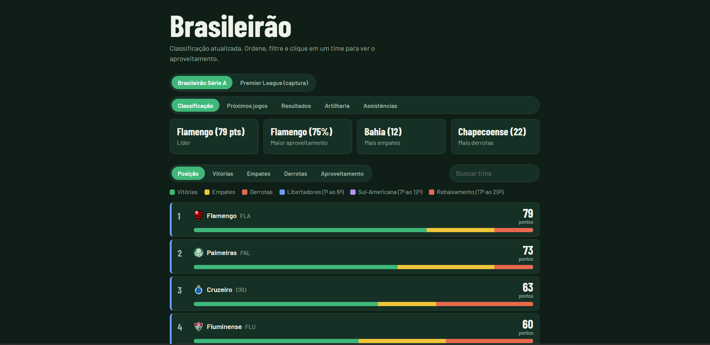
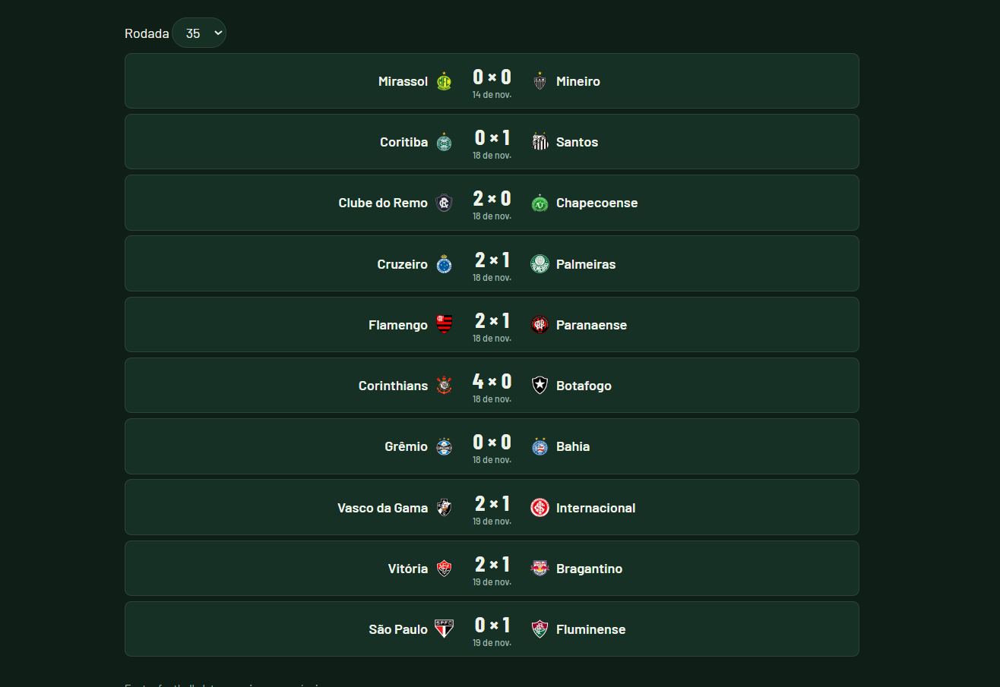
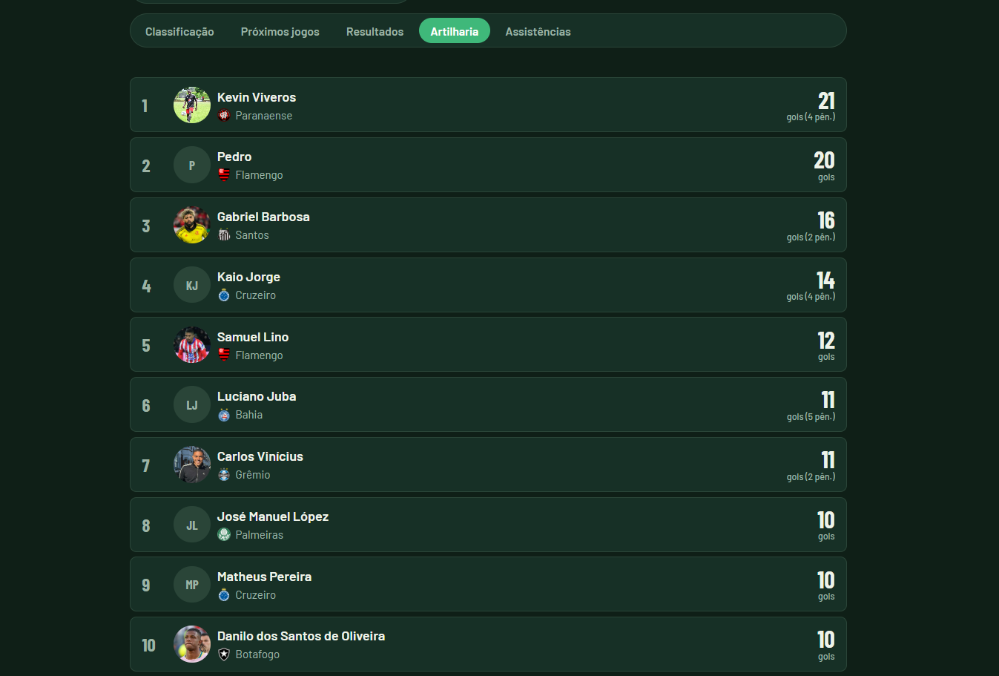

# Painel do Brasileirão

Painel interativo do Campeonato Brasileiro Série A com **dados reais**: classificação, resultados por rodada, próximos jogos, artilharia e assistências.

**Demonstração:** https://dashboard-brasileirao-painel.vercel.app



## Funcionalidades

- **Classificação** com ordenação (posição, vitórias, empates, derrotas, aproveitamento), busca por time e barras de campanha (V/E/D)
- **Zonas do campeonato** destacadas: Libertadores, Sul-Americana e rebaixamento
- **Detalhes por time** ao clicar: aproveitamento, pontos por jogo, gols pró/contra, saldo e os 3 próximos jogos
- **Resultados** de qualquer rodada, com escudos e placares
- **Próximos jogos** por rodada, com horário no fuso do usuário
- **Artilharia e assistências** com fotos dos jogadores
- Tema claro e escuro automático, layout responsivo e navegação por teclado

| Resultados | Artilharia |
| --- | --- |
|  |  |

## Tecnologias

- HTML, CSS e JavaScript puros (sem framework)
- Funções serverless na Vercel (Node.js)
- API da [football-data.org](https://www.football-data.org)
- API da Wikipédia para fotos de jogadores

## Decisões técnicas

- **Proxy serverless:** o token da API fica em variável de ambiente e nunca chega ao navegador. O front-end só chama as rotas `/api/*` do próprio site.
- **Cache de 10 minutos** nas respostas (`s-maxage`), que protege o limite de chamadas do plano gratuito (10 por minuto) e deixa a página mais rápida.
- **Uma única chamada para todos os jogos:** resultados, próximos jogos e agenda de cada time vêm da mesma resposta, que é guardada em memória no navegador.
- **Fotos com verificação:** a foto só aparece se a página da Wikipédia for de um futebolista e o texto citar o clube do jogador. Se não houver correspondência, o painel mostra as iniciais, para evitar foto de homônimo.
- **Estados de carregamento e erro** em todas as telas, com botão para tentar de novo.
- **Acessibilidade:** foco visível, controles operáveis por teclado e respeito à preferência de movimento reduzido.

## Como rodar localmente

1. Instale o [Node.js](https://nodejs.org)
2. Crie uma conta gratuita na football-data.org e copie o token
3. Copie `.env.example` para `.env.local` e preencha `FOOTBALL_DATA_TOKEN`
4. Rode `node dev-server.js` e abra http://localhost:3000

## Como publicar

1. Suba o projeto para um repositório no GitHub
2. Importe o repositório na [Vercel](https://vercel.com/new)
3. Crie a variável `FOOTBALL_DATA_TOKEN` em *Settings > Environment Variables* antes do deploy

## Estrutura

```
public/index.html     painel (front-end)
api/standings.js      classificação
api/matches.js        jogos (finalizados e agendados)
api/scorers.js        artilharia e assistências
dev-server.js         servidor local equivalente às funções
```

## Limitações conhecidas

- O plano gratuito da football-data.org limita as chamadas e não fornece fotos de jogadores.
- A cobertura das fotos depende da Wikipédia: jogadores menos conhecidos aparecem com iniciais.
- As assistências consideram os jogadores presentes na lista de artilharia retornada pela API.

## Autor

**Johnatan Flores**

- Portfólio: [johnatantech.github.io](https://johnatantech.github.io/)
- LinkedIn: [linkedin.com/in/johnatan-flores-67595a221](https://www.linkedin.com/in/johnatan-flores-67595a221)
- GitHub: [@johnatantech](https://github.com/johnatantech)
